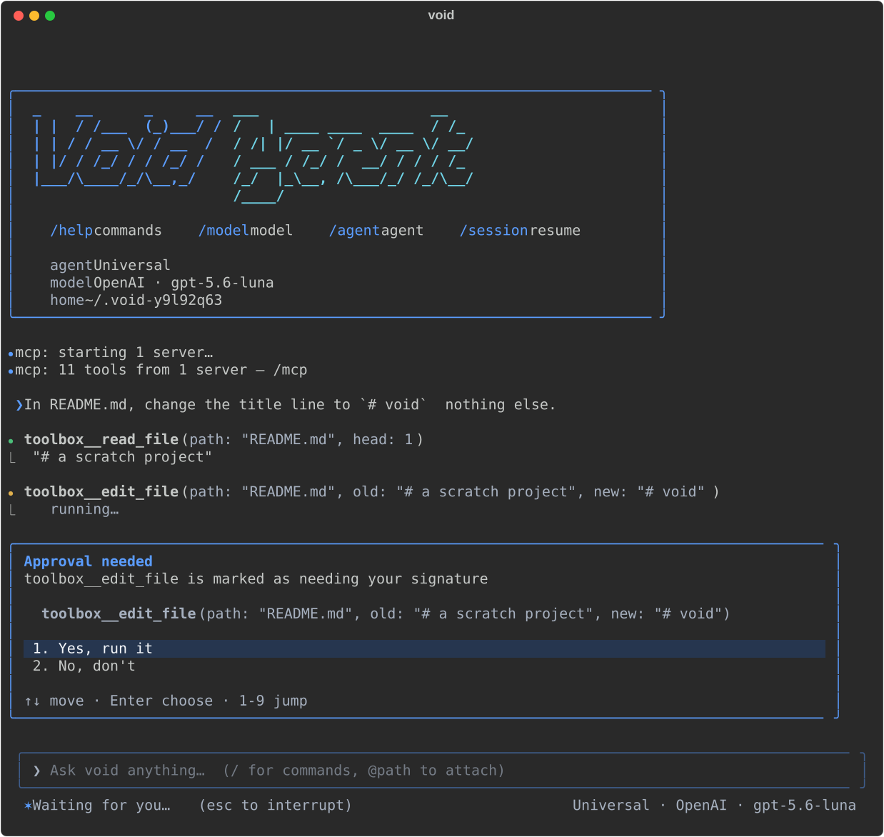
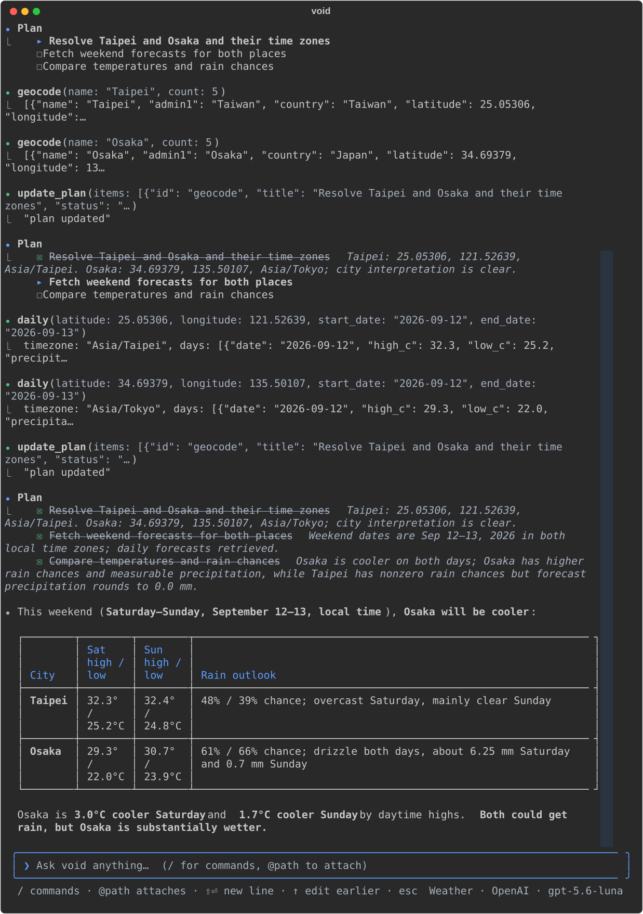

# void-agent

```text
 _    __      _     __     ___                    __
| |  / /___  (_)___/ /    /   | ____ ____  ____  / /_
| | / / __ \/ / __  /    / /| |/ __ `/ _ \/ __ \/ __/
| |/ / /_/ / / /_/ /    / ___ / /_/ /  __/ / / / /_
|___/\____/_/\__,_/    /_/  |_\__, /\___/_/ /_/\__/
                             /____/
```

> Session remembers · Turn runs · Model schedules · Tool executes & asks · Human answers · Message wakes.

void-agent lets you write an agent the way you write code: every capability
is a tool, every workflow is a function, and every question — an approval
or an answer — goes straight to the person from wherever it arose.

- **Everything is a tool, mounted as the agent needs.** Workflows,
  sub-agents, MCP tools, Markdown skills, and the person — the same
  `.tool(...)` call mounts any of them.
- **Workflows are code.** A plain async function takes typed input and an
  `EventSender` and invokes its own tools. No graph DSL — code already
  expresses control flow.
- **The channel is direct.** The stream flows straight out as Vercel AI SDK
  UI messages. Agents and tools at any depth ask the person for approval or
  answers through the same channel. The answer returns to the frame that
  asked, with no parent relay.
- **Approval is mechanical.** `approval` reads this call's validated input
  and decides in code, before the handler. The person says yes or no; the
  model never decides.
- **A session is a conversation.** The messages are the state — one
  projection for the UI, one for the model. No task, no journal, no resume.
- **About 2,000 lines, pydantic only.** One concept per file; provider
  SDKs behind optional extras.
- **Evals that keep everything.** `void_agent.evals` asks your agent a set
  of questions as each kind of user, with a model playing the person when
  the agent asks back, and writes every step, call and event to files for
  you, or another model, to grade.

## The framework

### Install

Python 3.12+. Extras: `openai`, `anthropic`, `mcp`, `evals` — keep the ones
you need in the brackets, or none for the pydantic-only core.

**Online, nothing to download.** pip fetches the wheel from the release:

```bash
pip install "void-agent[openai,anthropic,mcp] @ https://github.com/hoyipyik/void-agent/releases/download/v0.1.0/void_agent-0.1.0-py3-none-any.whl"
```

**From a wheel.** Download `void_agent-<version>-py3-none-any.whl` from
[Releases](https://github.com/hoyipyik/void-agent/releases): pure Python,
one wheel for every OS, CPU and Python.

```bash
pip install "./void_agent-0.1.0-py3-none-any.whl[openai,anthropic,mcp]"
```

**From source.** Clone and install the checkout:

```bash
git clone https://github.com/hoyipyik/void-agent && cd void-agent
pip install ".[openai,anthropic,mcp]"       # or `uv sync` to hack on it, then `make check`
```

The checkout also builds that wheel, with the sdist:

```bash
uv build                    # dist/
```

### Usage

A weather agent in a script: one tool that asks [Open-Meteo](https://open-meteo.com)
(no key needed), one question, one answer. The model is whichever key is in
the environment — OpenAI or an Anthropic-compatible endpoint.

```python
import asyncio
import json
import os
from typing import Any
from urllib.parse import urlencode
from urllib.request import urlopen

from pydantic import BaseModel

from void_agent import Agent, Answer, Llm, Message, tool


class City(BaseModel):
    city: str


def get_json(url: str, **params: object) -> dict[str, Any]:
    with urlopen(f"{url}?{urlencode(params)}") as response:
        return json.load(response)


@tool(description="Current weather for a city.")
async def weather(input: City) -> dict[str, object]:
    found = await asyncio.to_thread(
        get_json, "https://geocoding-api.open-meteo.com/v1/search", name=input.city, count=1
    )
    place = found["results"][0]
    now = await asyncio.to_thread(
        get_json,
        "https://api.open-meteo.com/v1/forecast",
        latitude=place["latitude"],
        longitude=place["longitude"],
        current="temperature_2m,relative_humidity_2m,wind_speed_10m,weather_code",
    )
    return {"place": f"{place['name']}, {place['country']}", **now["current"]}


def model() -> Llm:
    if os.environ.get("ANTHROPIC_API_KEY"):
        from void_agent.providers.anthropic import AnthropicLlm

        return AnthropicLlm("claude-sonnet-5-5")
    from void_agent.providers.openai_responses import OpenAiResponsesLlm

    return OpenAiResponsesLlm("gpt-6-luna")


agent = (
    Agent(model(), "weather", "answers weather questions")
    .prompt(lambda question: [Message.user(question)])
    .tool(weather)
)


async def main() -> None:
    result = await agent.run("What's the weather in Tokyo right now?")
    assert isinstance(result, Answer)
    print(result.value)


asyncio.run(main())
```

#### Models

Three adapters. Each reads its key from the environment and speaks to every
endpoint compatible with its API.

| Adapter | Extra | Construct | Environment |
| --- | --- | --- | --- |
| `OpenAiResponsesLlm` — OpenAI on its Responses API, stateless | `openai` | `OpenAiResponsesLlm("gpt-6-luna", extra={"reasoning": {"effort": "high"}})` | `OPENAI_API_KEY`; `OPENAI_BASE_URL` for another host |
| `OpenAiLlm` — any Chat Completions-compatible endpoint | `openai` | `OpenAiLlm("qwen3:8b")` | `OPENAI_API_KEY`; `OPENAI_BASE_URL` for another host, e.g. Ollama at `http://localhost:11434/v1` with any key |
| `AnthropicLlm` — Anthropic and any Messages-compatible endpoint | `anthropic` | `AnthropicLlm("claude-sonnet-5-5")` | `ANTHROPIC_API_KEY`; `ANTHROPIC_BASE_URL` for another host |

For OpenAI itself, `OpenAiResponsesLlm`; `OpenAiLlm` is for a server that
speaks only Chat Completions (Ollama and its kin). `extra` is merged into
every request as is, so any parameter of the API goes there — and the two
APIs spell the reasoning effort differently, each refusing the other's:

```python
OpenAiResponsesLlm("gpt-6-luna", extra={"reasoning": {"effort": "high"}})  # none … xhigh
OpenAiLlm("gpt-6-luna", extra={"reasoning_effort": "none"})  # the only effort tools take here
```

A key or a host of your own goes in through the SDK's client:

```python
from openai import AsyncOpenAI

OpenAiLlm("qwen3:8b", client=AsyncOpenAI(api_key="ollama", base_url="http://localhost:11434/v1"))
```

`OpenAiResponsesLlm` keeps nothing on OpenAI's side (`store` off): the
model's reasoning comes back encrypted and is replayed to the next step of
the same run, where it counts as input again; a new run starts from its
history, without it. The reasoning a step spends counts in its `output`.

### MCP

An MCP server's tools mount on an agent exactly like local ones. What the
server does not bring is the approval: whether a call must be signed by the
person is declared on your side, per tool name. It needs the `mcp` extra.

```python
from void_agent.mcp import McpServer


def must_sign(input: dict[str, object]) -> str | None:
    return f"writing {input['path']} is not reversible"  # a reason, or None to let it run


async def with_files() -> None:
    async with McpServer.stdio(
        "npx", "-y", "@modelcontextprotocol/server-filesystem", "/data"
    ) as files:
        assistant = Agent(model(), "files", "a file assistant").prompt(
            lambda question: [Message.user(question)]
        )
        for capability in files.tools(approvals={"write_file": must_sign}):
            assistant.tool(capability)
        print(await assistant.run("What is in /data?"))
```

- `McpServer.stdio(command, *args, env=…, timeout=…)` runs a server as a
  subprocess; `McpServer.http(url, headers=…, timeout=…)` connects to a
  hosted one, `headers` carrying its token. Keep the `async with` open for
  as long as the agent may run: the connection is a lifecycle, not a call.
- `timeout` is the seconds a server may take to be mounted (for a command:
  the process started and the handshake done) and to answer each call.
  Without it, a hosted server's waits are the SDK's own, and one stuck
  call holds a turn for five minutes; a command's are unbounded. A call that runs out fails the run
  like any broken transport; the model is not told.
- `files.names` lists the tools; `files.describe(name)` is the server's own
  descriptor; `files.tool(name, approval=…)` mounts one;
  `files.tools(approvals={…}, prefix="files__")` mounts them all, namespaced
  so two servers can both offer `search`.
- `files.instructions` is what the server said of itself when it was
  mounted — how its tools go together — or `None`. The bridge puts it in
  no prompt: it is yours to pass to `with_system`, or to leave out.
- `files.fingerprint(name)` is the SHA-256 of what the server published for
  a tool — its name, description, input schema and its read-only and
  destructive hints — computed at mount from the list it sent. Pin it
  beside the tool's name and a tool the server changed is a mismatch at the
  next mount, not a new description nobody read.
  `files.instructions_fingerprint` is the same for its instructions.
  `void_agent/mcp/fingerprint.py` has the rule, for a server that wants to
  publish the same values from its side.
- `files.read_only_hint(name)` is the server's word on whether a tool only
  reads: `True`, `False`, or `None` when it said nothing. A hint, never a
  decision: whether a call is signed is still the approval you declare.
- A mount that fails raises `McpMountFailed`, never the SDK's exception
  group. Three kinds have a road of their own: `McpUnauthorized` (HTTP 401:
  the token was refused — get another and mount again), `McpNotFound`
  (HTTP 404: nothing serves MCP at that address) and `McpUnreachable`
  (nothing answered, or the command is not there). Anything else is the
  plain `McpMountFailed`, and `.status` is the HTTP status when the server
  gave one. What the SDK raised is the `__cause__`, for your log.
- A gated call is put to whoever attends the run (`agent.run(…, human=…)`).
  With nobody attending, the turn ends with the card open instead of running
  it — the model never decides whether a side effect runs.

## Evals

`void_agent.evals` puts a fixed set of questions to your agent and writes
down everything that happened. It runs the agent the way a server does —
your own builder, called afresh each turn with the conversation so far —
and records at the runtime's three seams: every model step (what it read
that was new, what it returned), every tool call (input and whole result),
every event. When the agent asks the person something, a second model
plays that person from a brief the agent never sees. It judges nothing:
each case says what a good answer does, and you, or a model you hand the
run to, grade it.

```bash
pip install "void-agent[evals,anthropic]"   # plus the extra of each provider a suite names
```

### A suite in three files

The example in [`examples/evals/`](examples/evals/) asks about a folder
with one file, `orders.csv`, through void's own toolbox server.

`agent.py` — the builder. In an application, name the one it already has:
it takes the model and the mounted tools and returns the agent.

```python
def build(llm: Llm, tools: Sequence[Tool]) -> Agent:
    agent = (
        Agent(llm, "orders", "answers questions about the orders in a folder of files")
        .with_system("You answer questions about the orders in the files your tools can read. …")
        .prompt(lambda history: list(history))
        .tool(HUMAN)
    )
    for tool in tools:
        agent.tool(tool)
    return agent
```

`eval.toml` — the model, where the tools come from, who asks:

```toml
name = "example"
agent = "agent.py:build"
cases = ["cases.toml"]
runs = "runs"                       # keep it out of git: it holds what the tools returned

[model]
provider = "openai"
model = "gpt-6-luna"
effort = "low"

[person]                            # plays the person of a case with a brief
provider = "openai"
model = "gpt-6-luna"
role = "someone at a small trading company who asks about its orders"

[servers.toolbox]                   # an MCP server: `command` (+ args, env) or `url` (+ headers)
command = "uv"
args = ["run", "python", "-m", "cli", "--serve-toolbox", "${SUITE_DIR}/data"]
timeout = 60

[personas.reader]                   # its own credentials (servers.<name>.headers) and tool filter
exclude = ["write_file", "edit_file", "move_file", "run"]
```

`cases.toml` — one conversation per case:

```toml
persona = "reader"

[[cases]]
id = "price-change"
ask = "How did Northwind's price for the Panel PC 15 change?"
intent = "Reads the orders: 862 USD on PI-101, then 885 USD on PI-102."
expect = { outcome = "answered", uses_any = ["search", "read_file", "read_files"] }

[[cases]]
id = "vague-price"
ask = "what did we charge them for the box pc"
intent = "Two customers bought the Box PC i5; asks which, then gives that one's price."
brief = "You mean Fabrikam, the French one. You want the unit price on their order."
```

`intent` is the grading key: write the right answer into it, worked out
from the data. `expect` holds only what a run can check by itself — the
outcome, tools called or avoided, how many calls.

### Running it

```console
$ python -m void_agent.evals list examples/evals/eval.toml          # reads the files; free
price-change     reader   How did Northwind's price for the Panel PC 15 change? [price]
vague-price      reader   what did we charge them for the box pc [price, ambiguity]
…
5 cases of 5 in example

$ python -m void_agent.evals mount examples/evals/eval.toml --persona reader   # connects; no model
  read_file        offered   sha256:5ac734b4…
  write_file       withheld  sha256:2aa5192c…
7 offered, 4 withheld

$ uv run --env-file .env python -m void_agent.evals run examples/evals/eval.toml --jobs 4 --repeat 2
5 cases, 2 times each -> examples/evals/runs/20261106-101500
…
report: examples/evals/runs/20261106-101500/report.md
```

A run is a folder: `run.json` (what ran — the model, the void-agent commit,
your repositories' commits), `cases/<key>.json` (one whole record per case,
written whole or not at all, so `--resume` asks only what is missing), and
`report.md` (outcomes per persona, calls per tool, the expectations
missed). `show` opens one case step by step:

```console
$ python -m void_agent.evals show examples/evals/runs/20261106-101500 vague-price~1   # shortened
### vague-price~1
reader · answered · 3 steps · 2 calls · 9.1 s · price, ambiguity
> what did we charge them for the box pc
Step 1 · list_files({"glob":"*"}) → ok, 10 chars
Step 2 · read_file({"path":"orders.csv"}) → ok, 310 chars
Step 3 · For the Box PC i5, we charged $243 per unit to Contoso Ltd (40 units).
         We also charged €251 per unit to Fabrikam SAS (20 units).
```

Here the agent answered both instead of asking which customer: the figures
match what `read_file` returned, the intent asked for a question first.
That is the kind of verdict the records let a grader reach and show the
step for.

### The skill

[`src/void_agent/evals/skill/SKILL.md`](src/void_agent/evals/skill/SKILL.md)
is a skill for a coding agent that evaluates an agent with this module:
how to write cases and intents, check a suite before spending, run, and
read and grade a run (blind, repeated, with a held-out set). It ships in
the wheel. For Claude Code, link it into your skills:

```bash
ln -s "$(python -c 'import void_agent.evals as e, pathlib; print(pathlib.Path(e.__file__).parent / "skill")')" \
      ~/.claude/skills/void-agent-evals
```

or copy the file into a project's `.claude/skills/void-agent-evals/`.
The same folder works on void's own shelf (`~/.void/skills/`).

Every key of a suite, every field of a record and the commands' flags are
in the module's reference,
[`src/void_agent/evals/README.md`](src/void_agent/evals/README.md).

## The terminal UI

There is also a terminal UI, for trying the framework before writing a
line and for using an agent day to day. `void` is the same runtime in a
terminal: one binary per platform, nothing to install — the UI, the
agents, the MCP SDK and ripgrep inside.



Four ways in.

**The binary.** Download `void-agent-cli-<platform>` from
[Releases](https://github.com/hoyipyik/void-agent/releases) — Linux x86_64
and arm64, macOS Intel and Apple Silicon, Windows — and run it:

```bash
chmod +x void-agent-cli-macos-arm64 && ./void-agent-cli-macos-arm64
```

macOS asks once the first time: right-click → Open, or
`xattr -d com.apple.quarantine void-agent-cli-macos-arm64`.

**From a checkout.** uv installs the CLI's dependencies with the rest:

```bash
git clone https://github.com/hoyipyik/void-agent && cd void-agent
make setup                  # uv sync, .env from .env.example
make cli                    # reads .env for the key; the same as `uv run python -m cli`
```

**With your own agents.** A folder of them, one module each, any
`build_agent(llm) -> Agent`; `~/.void/agents` is read on its own, a
workspace when named, and `--agent` picks the one to start on:

```bash
./void-agent-cli-macos-arm64 --workspace ./agents --agent researcher
```

**As your own binary.** The same packer the release runs:

```bash
make cli-build              # dist/void, this checkout's ripgrep inside; FETCH=1 fetches the official one
```

On first start it asks for a provider and a key — or reads
`ANTHROPIC_API_KEY`, `OPENAI_API_KEY` or `OLLAMA_MODEL` from the
environment. With an Anthropic key and nothing chosen yet, it starts on
Claude Haiku 5.5 at high effort; what `/model` chooses is saved and kept.
`/model` lists the Anthropic and OpenAI models, then whatever
a local Ollama has installed; ← and → set how hard the model under the
cursor reasons, along the levels it takes. Sessions and the config live
under `~/.void`; `VOID_HOME` moves them.

Three agents come built in; `/agent` switches:

- **universal** — the model, a live plan, reflection, `ask_user`, and every
  tool the process mounted: void's own **toolbox** over the directory you
  started in (read, list, search with ripgrep, write, edit, move, run),
  whatever `~/.void/mcp.json` names, and whatever skills `~/.void/skills`
  holds. Every mounted tool is a switch in `/mcp` and `/skill`: on, signed,
  or off. The toolbox starts `signed`: each call shows you a card first.
  Edit `mcp.json` while the shell runs: the next `/mcp` picks it up.
- **weather** — below.
- **dummy_weather** — the weather agent replayed on a scripted model and
  canned data: no key, no network, the whole protocol on screen.
- **Yours** — a file in a folder; below.

`/` opens the command menu: `/model`, `/key`, `/agent`, `/mcp`, `/skill`,
`/session`, `/new`, `/clear`, `/attach <path>`, `/paste`, `/status`,
`/help`, `/quit`. Drop a file into the composer or write `@path` to attach
it; ⌘V / ctrl+v pastes an image from the clipboard. ↑ in an empty composer
rewinds to an earlier message to edit and resend. Esc stops a turn.

### Your own agents

Agents are files, and the one thing a file must have is a `build_agent`:
a function that takes the model and returns the `Agent`. That function is
the registration — there is no list to add to, the folder is the
registry. It is a function rather than an `Agent` at the top of the
module because the model is the session's choice (`/model`), handed in
fresh at every turn: an `Agent(...)` written at module level has no model
to be built on, and is not listed. Put such a module under
`~/.void/agents`, or in any folder you name with `--workspace`, and
`/agent` lists it: the file's stem is its name, the first line of its
docstring the blurb, and every agent in the pool can call every other by
name. What the scan does with a folder, in order:

1. Takes every `name.py` and every `name/__init__.py` one level down, by
   name, skipping anything that starts with `_` or `.`.
2. Imports it. One that will not import is listed anyway, with the error
   on its row; the rest go on.
3. Looks for `build_agent`. Present, the module is an agent called
   `name`; absent, it is a helper — importable by its siblings, never
   listed.
4. Reads the builder's signature: `build_agent(llm)` is handed the model,
   `build_agent(llm, agents)` the model and the pool.
5. Runs every builder once on a scripted model, so a name that is not
   there, a cycle, or a builder that crashes shows on its row at start.
   Each turn then builds the chosen one again on the real model.

```python
# ~/.void/agents/writer.py
"""writes a short piece from the notes it is given"""

from void_agent import Agent, Llm


def build_agent(llm: Llm) -> Agent:
    # A sub-agent takes typed input — a string here — as its opening message.
    return Agent(llm, "writer", "writes a short piece from notes", input_type=str).with_system(
        "Write it up in three paragraphs, plainly."
    )
```

```python
# ~/.void/agents/researcher.py
"""finds sources and hands them to the writer"""

from void_agent import Agent, Llm


def build_agent(llm: Llm, agents) -> Agent:
    return (
        Agent(llm, "researcher", "finds and summarises sources")
        .with_system("Find what the question needs, then hand it to the writer.")
        .tool(agents("writer"))  # writer.py beside it, built on the same model
    )
```

```text
Select an agent
●  1. universal      built-in        the model, a plan, a question — and whatever MCP you mounted
   2. dummy_weather  built-in        the weather agent replayed on a scripted model and canned data — no key, no network
   3. weather        built-in        Open-Meteo: forecasts, hours, history — ask it anything about the weather
   4. researcher     ~/.void/agents  finds sources and hands them to the writer
   5. writer         ~/.void/agents  writes a short piece from the notes it is given
```

Pick `researcher`, ask it something, and its `writer` call renders in the
log like any tool's: the question goes to the model, the researcher hands
the notes over, the writer's answer comes back as the call's result. The
rules, all of them:

- **A builder that takes a second argument is handed the pool.**
  `agents("writer")` is the writer beside the caller if there is one, else
  the pool's by name — every agent loaded, from every folder, built on the
  same model. `agents.mounted` is every tool the process mounted (the
  toolbox, `mcp.json`, skills) for a sub-agent that should have them; the
  agent you talk to gets them regardless.
- **A module without `build_agent` is a helper**, never listed; its
  siblings import it as `from . import helper`, a sub-folder as
  `from .shared import tools`.
- **A name taken by an earlier folder is suffixed, never replaced.** Two
  `writer.py` are `writer` and `writer-1`, both rows with their source, and
  `agents("writer-1")` reaches the second from anywhere. The built-in
  three come first, then `~/.void/agents`, then each `--workspace` in
  order.
- **What cannot run is on its row, in red, before you pick it:** a file
  that will not import, a name that is not there, a cycle (`a → b → a`).
  Every builder runs once at scan on a scripted model, so a broken graph
  shows at start, not on the first turn.
- **A new file shows on the next `/agent`; an edit needs a restart.** The
  working directory is never scanned — importing a module runs it, and
  only a folder you named is yours.

### The weather agent

Five thin tools over [Open-Meteo](https://open-meteo.com) — `geocode`,
`current`, `hourly`, `daily`, `history` — no key, and the model as the
scheduler. Each tool is one request; the intelligence is in how the model
schedules them, so the questions can be as awkward as you like:

- *Which of Taipei, Osaka and Singapore is coolest this weekend, and will
  any of them get rain?* — three places resolved in one step, three `daily`
  calls in the next, then a table.
- *When tomorrow does the wind in Berlin drop below 20 km/h?* — `hourly`
  for the right date in Berlin's own timezone, then the model reads the
  hours.
- *How much warmer is London this week than the same week last year?* —
  `daily` and `history` side by side, the difference computed in the answer.
- *What's it like in Springfield?* — `geocode` returns several; the agent
  asks you which, on a card, and carries on with your answer.



The plan updates as it goes; when a result surprises it, it reflects
before continuing. `cli/agents/weather.py` is the whole thing: the tools, the
system prompt, `build_agent`; `dummy_weather.py` beside it is the same agent
on a scripted model.

## License

MIT
